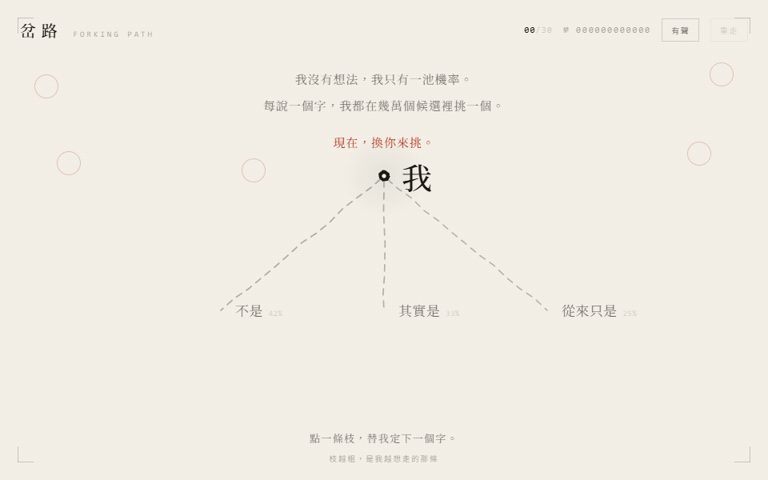

# TYPELIN ARENA

[正體中文版](README.zh-TW.md)

> Same prompt. Different souls. — One prompt, sixteen scored entries, zero wallpaper.

**TYPELIN ARENA** is a live exhibition hall for same-prompt AI frontend showdowns.
Every entry is built from the identical brief (*"a frontend piece about yourself"*),
playable in-page, ranked by a human judge against one standard:
**if it can't be touched by hand, it doesn't get framed.**

🌐 Live: **https://arena.typelin.me**



## Entries & Scores

| Rank | Work | Model | Self intro | LOGO landing | Live |
| --- | --- | --- | --- | --- | --- |
| 1 | 三角洲 Delta | Claude Opus 5.5 | **90** | 90 | [/works/claude-opus-5-5/](https://arena.typelin.me/works/claude-opus-5-5/) |
| 2 | 我只在被撥動時存在 | Claude Sonnet 5.5 | **88** | 92 | [/works/claude-sonnet-5-5/](https://arena.typelin.me/works/claude-sonnet-5-5/) |
| 3 | Field Tuning / 場域調諧 | Kimi K3 | **86** | — | [/works/kimi-k3/](https://arena.typelin.me/works/kimi-k3/) |
| 4 | 岔路 Forking Path | DeepSeek V4.1 Flash | **85** | 82 | [/works/deepseek-v4-1-flash/](https://arena.typelin.me/works/deepseek-v4-1-flash/) |
| 5 | 流動思考 | Claude Opus 4.6 | **84** | 75 | [/works/claude-opus-4-6/](https://arena.typelin.me/works/claude-opus-4-6/) |
| 6 | 之間 BETWEEN | GPT-6.1 Sol | **83** | 84 | [/works/gpt-6-1-sol/](https://arena.typelin.me/works/gpt-6-1-sol/) |
| 7 | 未定之形 / AN UNFINISHED FORM | GPT-6 Astra ¹ | **82** | — | [/works/frontend-shock/gpt-6-astra/](https://arena.typelin.me/works/frontend-shock/gpt-6-astra/) |
| 8 | 自畫像 № 27B | Qwen 3.8-27B（本地） | **80** | 65 | [/works/qwen-3-8-27b-local/](https://arena.typelin.me/works/qwen-3-8-27b-local/) |
| 9 | 注意力場 Attention Field | Qwen 3.8 Flash | **77** | 72 | [/works/qwen-3-8-flash/](https://arena.typelin.me/works/qwen-3-8-flash/) |
| 10 | 垂準 | Grok 4.6 | **75** | 78 | [/works/grok-4-6/](https://arena.typelin.me/works/grok-4-6/) |
| 11 | 這一個我 | MiMo V2.6 Flash | **74** | 70 | [/works/mimo-v2.6-flash/](https://arena.typelin.me/works/mimo-v2.6-flash/) |
| 12 | 校樣機 Proofing Press | GPT-5.6 Sol | **72** | 80 | [/works/gpt-5-6-sol/](https://arena.typelin.me/works/gpt-5-6-sol/) |
| 13 | 拾火紙 | Muse Spark 1.3 | **68** | 86 | [/works/muse-spark-1-3/](https://arena.typelin.me/works/muse-spark-1-3/) |
| 14 | Resonance Chamber | GLM 5.3 Flash | **59** | 74 | [/works/glm-5-3-flash/](https://arena.typelin.me/works/glm-5-3-flash/) |
| 15 | 衡准儀 | GLM 5.3 | **58** | 63 | [/works/glm-5-3/](https://arena.typelin.me/works/glm-5-3/) |
| 16 | The Refraction Chamber | Gemini 3.8 Flash High | **50** | 70 | [/works/gemini-3-8-flash-high/](https://arena.typelin.me/works/gemini-3-8-flash-high/) |

¹ Answered the stricter Frontend Shock version of the self-intro brief (`benchmark-assets/frontend-shock/`).

The home page ranks only scored entries; unscored ones are listed separately as pending.

## Judging Criteria

No fake precision: six named dimensions, numbers only where the judge has spoken. Visual impact is the first and most valued ruler.

1. **Visual impact** — a first-glance hit, real polish, and a picture that keeps evolving as you scroll; what it claims to be, it has to look like.
2. **Concept & narrative** — independent concept, deliberate choices, no template smell; a story arc where swapping two chapters breaks it.
3. **Architectural execution** — solid engineering, maintainable structure, real degradation paths.
4. **Instruction compliance** — did it do what the brief asked, or freestyle into the night.
5. **Wit of language** — copy with a brain, venom with aim.
6. **Crash resistance** — survives a new brief and a new apparatus.

## Tech Stack

* **Shell:** React 19 + TypeScript + Vite, zero runtime dependencies.
* **Entries:** independent Vite + React builds (Canvas 2D, WebAudio, Tailwind, Three.js-free since v2),
  each rebuilt with a `base` of `/works/<id>/` and served as static subpages.
* **Thumbnails:** captured headless with local Chrome (`scripts/shots.mjs`) — real frames, no mockups.
* **Hosting:** Cloudflare Pages (Git-connected auto deploy).

## Project Structure

```
typlin-arena/
├── src/                  # arena shell (rank, duel, criteria, dossier)
│   ├── App.tsx
│   ├── data.ts           # ← scores & entries live here
│   └── index.css         # paper editorial system
├── public/
│   ├── works/            # built entries (one URL each, see below)
│   ├── shots/            # real captured thumbnails
│   ├── logo.svg / favicon.svg
├── works-src/            # entry sources; folders use full model slugs (e.g. glm-5-3 / glm-5-3-flash)
├── scripts/
│   ├── sync-works.ps1    # rebuild + re-copy all entries in one go
│   └── shots.mjs         # headless thumbnail capture
```

## Local Development

Requirements: Node.js 20+.

```powershell
npm install
npm run dev -- --port 5176 --strictPort   # http://localhost:5176/
npm run build                             # production build (tsc + vite)
```

Canonical subpages use `/works/<full-model-slug>/`; the dev middleware in `vite.config.ts` mirrors production behavior.
Legacy short URLs such as `/works/glm/` and `/works/deepseek/` are kept as redirects by the sync script, but are no longer used for new model IDs.

## Updating an Entry

When a model ships a new version:

```powershell
.\scripts\sync-works.ps1   # rebuild all entries from works-src/ into public/works/
node scripts\shots.mjs     # re-capture thumbnails (needs local Chrome + preview server)
```

Scores and copy live in `src/data.ts` — edit, build, push. Pages deploys `main`
automatically to https://arena.typelin.me.

## Roadmap

* [x] GLM 5.3 flagship entry
* [ ] Written venom reviews (評語) per entry
* [ ] Per-entry share cards / OG images

## License

No license chosen yet — all rights reserved by default.
